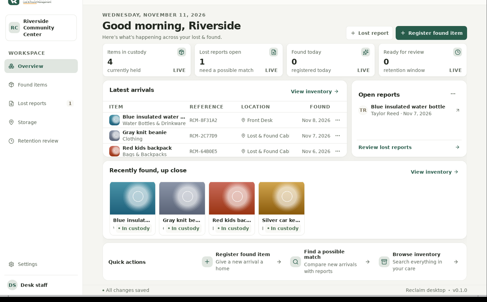
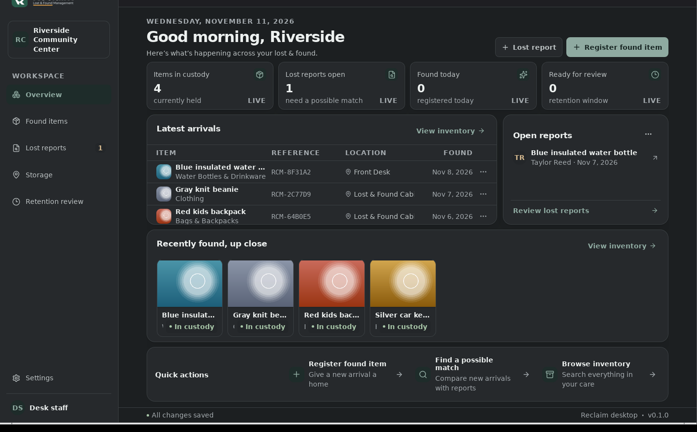
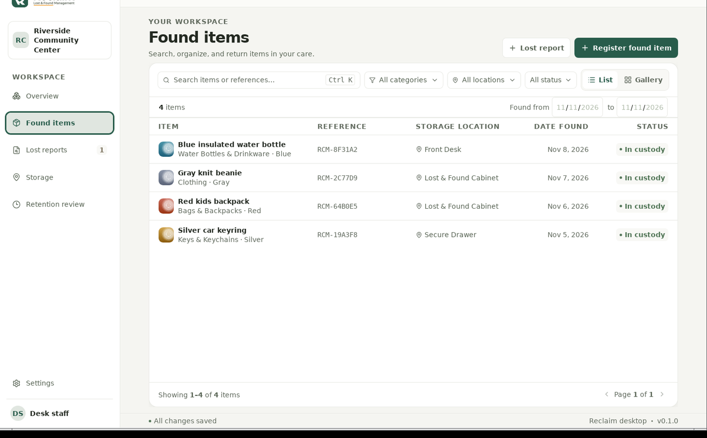
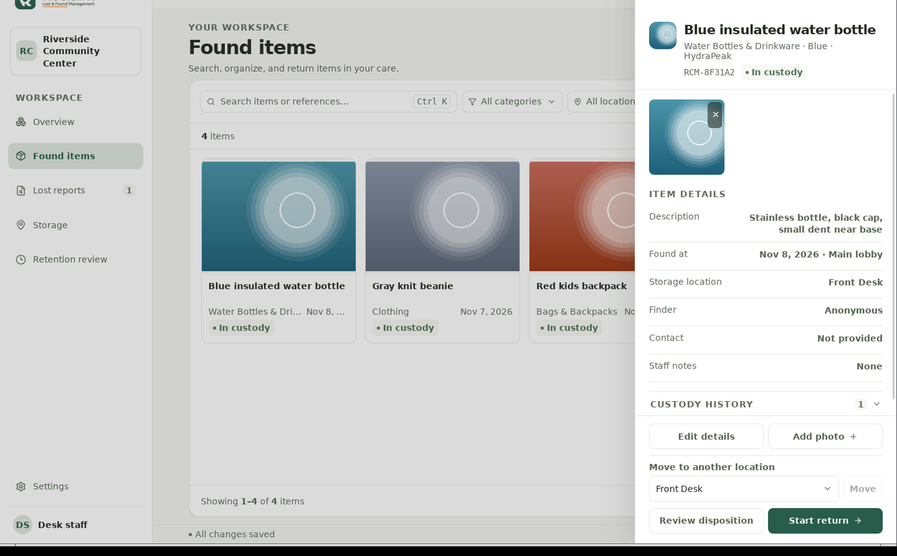
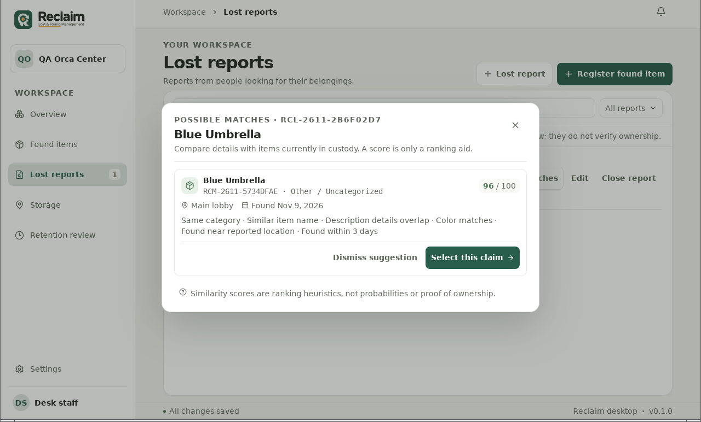
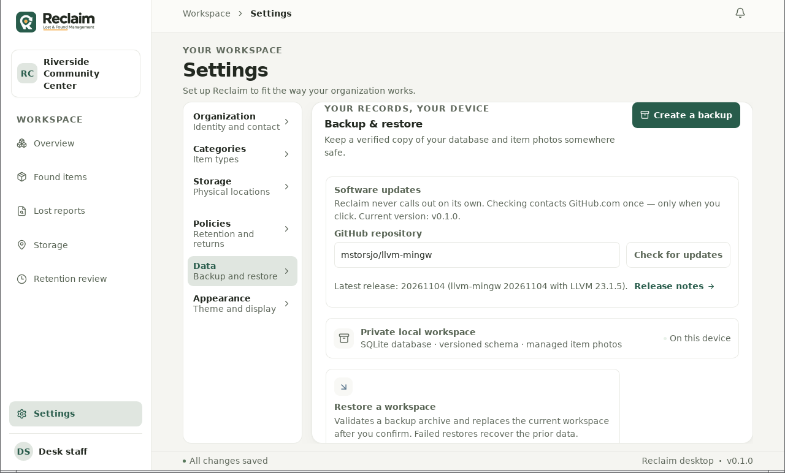

<div align="center">


# Reclaim

**Lost & found management that stays on your own computer.**

A calm, local-first desktop workspace for the things people leave behind — and the people looking for them. Built for a single organization: one desk, one database, no accounts, no cloud.

[](docs/release-notes-0.1.0.md)
[](#install)
[](LICENSE)


</div>

---

## Screenshots

<table>
  <tr>
    <td width="50%">
      
      <p align="center"><sub><b>Overview</b> — live metrics, photo gallery, and open reports</sub></p>
    </td>
    <td width="50%">
      
      <p align="center"><sub><b>Dark theme</b> — neutrals derived from your brand color</sub></p>
    </td>
  </tr>
  <tr>
    <td width="50%">
      
      <p align="center"><sub><b>Inventory</b> — list and gallery views, search, filters</sub></p>
    </td>
    <td width="50%">
      
      <p align="center"><sub><b>Item drawer</b> — full record, custody history, verified return</sub></p>
    </td>
  </tr>
  <tr>
    <td width="50%">
      
      <p align="center"><sub><b>Match review</b> — ranked suggestions are aids, never proof</sub></p>
    </td>
    <td width="50%">
      
      <p align="center"><sub><b>Manual update check</b> — only when you click</sub></p>
    </td>
  </tr>
</table>

## Why local-first

Lost and found records include people's names and contact details. Reclaim keeps them on the desk that collected them:

- **No accounts, no cloud, no telemetry.** Records and photographs are stored in your operating system's app-data folder. The app has no outbound network code paths — the single exception is **Settings → Data → Check for updates**, which contacts `api.github.com` only when you click it.
- **One organization, one workstation.** Multi-site organizations get locations and nested storage areas; there are no staff accounts or roles by design. The configured staff name is an attribution label, not authentication.
- **Explicit custody history.** Every registration, move, match decision, return, and disposition is recorded as an attributed custody event. Adjudication is deliberate: suggestions are ranked aids, confirming a claimant is a recorded decision, and two confirmed claimants for one item are impossible at the schema level.
- **Real verification.** Returns require documented proof of ownership when policy or secure storage demands it.
- **SQLite underneath.** A versioned, migratable schema with automated backup archives and restore validation.

## Install

Linux packages for the current release candidate:

```sh
# Debian / Ubuntu
sudo apt install ./Reclaim_0.1.0_amd64.deb

# Fedora / RHEL
sudo dnf install ./Reclaim-0.1.0-1.x86_64.rpm
```

Grab them from [Releases](../../releases). Both packages ship the desktop entry, hicolor icons, and license notices; your data directory is kept when you uninstall.

## Updating

Reclaim never phones home. When you want to see whether a newer release exists, open **Settings → Data → Software updates**, enter this project's GitHub repository as `owner/name`, and click **Check for updates** — that performs exactly one request to `api.github.com` and reports the result. Updates themselves are manual: close Reclaim, keep a backup, install the next package, and reopen.

## Privacy & data

| What | Where |
|---|---|
| Database | App-data folder (`~/.local/share/com.reclaim.desktop/` on Linux) |
| Photos | Managed subfolder next to the database |
| Backups | Wherever you choose to save the archive |
| Network | Nothing, until you click *Check for updates* |

Databases and backups are plain, unencrypted files — keep workstation and backup storage access limited. See [docs/user-guide/data-and-backups.md](docs/user-guide/data-and-backups.md).

## Building from source

Requirements: Rust stable, Node.js, pnpm, and the Tauri v2 host prerequisites.

```sh
pnpm install
pnpm tauri dev      # run the desktop app in development
pnpm tauri build --bundles deb,rpm
```

## Quality gates

```sh
pnpm test               # frontend journeys and guards
pnpm build              # TypeScript + production bundle
pnpm check:design       # color governance + accessible-name heuristics
pnpm check:contrast     # token contrast across curated brand colors
cargo test --manifest-path src-tauri/Cargo.toml
```

The full qualification evidence — packaging, installed-app journeys, screen-reader review, keyboard walks, and known limitations — lives in [docs/release-readiness.md](docs/release-readiness.md) and [docs/testing.md](docs/testing.md).

## Status: public beta

This is the **0.1.0 release candidate**. Known limitations ship documented: packages are unsigned, screen-reader live-region announcements are not spoken under the WebKitGTK stack (everything else is announced), and distribution is Linux-first (Windows compilation is verified; installers are planned via CI). The [release notes](docs/release-notes-0.1.0.md) and [release readiness document](docs/release-readiness.md) separate observed evidence from open items.

## Documentation

| Product | Engineering |
|---|---|
| [Getting started](docs/user-guide/getting-started.md) | [Architecture](docs/architecture.md) |
| [Daily operations](docs/user-guide/daily-operations.md) | [Database schema](docs/database-schema.md) |
| [Data and backups](docs/user-guide/data-and-backups.md) | [Domain model](docs/domain-model.md) |
| [Troubleshooting](docs/user-guide/troubleshooting.md) | [Application workflows](docs/application-workflows.md) |
| [Release notes](docs/release-notes-0.1.0.md) | [Design system](docs/design-system.md) · [Testing](docs/testing.md) |

## License

Released under the [MIT License](LICENSE) — Copyright © 2026 Kynex Media. Third-party components are covered by their own licenses; see [THIRD_PARTY_NOTICES.md](THIRD_PARTY_NOTICES.md), generated from the actual dependency graph by `scripts/generate-notices.mjs`.
